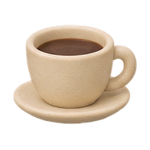
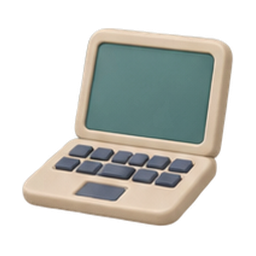
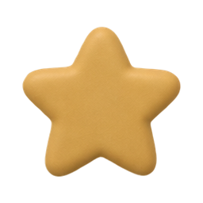

<div align="center">
  <h1>Clayfold</h1>
  <p>Clay-style 3D icons for apps and websites.</p>
  <p>
    <a href="https://zacbytes.github.io/clayfold/"></a>
    <a href="./catalog.json"></a>
    <a href="./ARTWORK-LICENSE.md"></a>
    <a href="https://github.com/ZacBytes/clayfold/stargazers"></a>
    <a href="#coverage"></a>
  </p>
  <p>
    <a href="https://zacbytes.github.io/clayfold/#icon=maritime"></a>
    <a href="https://zacbytes.github.io/clayfold/#icon=bookmark"></a>
    <a href="https://zacbytes.github.io/clayfold/#icon=coffee-cup"></a>
    <a href="https://zacbytes.github.io/clayfold/#icon=captions"></a>
    <a href="https://zacbytes.github.io/clayfold/#icon=laptop"></a>
    <a href="https://zacbytes.github.io/clayfold/#icon=star"></a>
  </p>
  <p><a href="https://zacbytes.github.io/clayfold/"><strong>Explore the icons</strong></a> &nbsp;&nbsp;&nbsp; <a href="./assets">Browse the files</a></p>
</div>

## Download the full pack

Each archive includes all 704 icons, including 200 country flags, with the catalog and artwork license.

[PNG ZIP](https://github.com/ZacBytes/clayfold/releases/download/v1.1.1/clayfold-png.zip) · [WebP ZIP](https://github.com/ZacBytes/clayfold/releases/download/v1.1.1/clayfold-webp.zip) · [SVG ZIP](https://github.com/ZacBytes/clayfold/releases/download/v1.1.1/clayfold-svg.zip)

## Install with npm

Each new [GitHub release](https://github.com/ZacBytes/clayfold/releases) includes a versioned npm archive. The package contains all 704 WebP icons, the catalog and the artwork license, with zero runtime dependencies.

```sh
npm install https://github.com/ZacBytes/clayfold/releases/download/v1.1.1/clayfold-icons-1.1.1.tgz
```

Import individual files in a bundler with static image imports, such as Vite.

```js
import bookmark from "clayfold-icons/assets/bookmark.webp";

document.querySelector("#bookmark").src = bookmark;
```

Use the file names from [the catalog](./catalog.json), also available as `clayfold-icons/catalog.json`. Download PNG and SVG from the catalog or the full pack links above.

## Use an icon

Search by name, appearance, or purpose. Try **“save for later”** for Bookmark, or **“clean power”** for Renewables. Open any result to copy the SVG or download an individual file.

Drop a downloaded icon into your app’s assets directory and reference it directly.

```html

```

Use an empty `alt` when nearby text already describes the icon. For an icon-only button, give the button an accessible name such as `aria-label="Save for later"`.

| Format | Use it for |
| --- | --- |
| **WebP** | A compact, lossless image for the web |
| **PNG** | A transparent image for design tools and apps |
| **SVG** | A self-contained file that embeds the 256 × 256 PNG and preserves the original shading |

Every icon has a stable ID in [the catalog](./catalog.json). Files are named `assets/<id>.webp`, `assets/<id>.png`, and `assets/<id>.svg`.

The [icon font builder](https://zacbytes.github.io/clayfold/font-demo.html) exports a color font with your selected icons. The ZIP includes the stylesheet, a name-to-glyph map, and the artwork license.

## Coverage

- **Navigation and layout** — arrows, chevrons, menus, panels, grids, and window controls.
- **Files and actions** — documents, folders, attachments, clipboard, archive, and sharing.
- **Text editing** — bold, italic, underline, alignment, lists, undo, and redo.
- **Accessibility** — wheelchair access, captions, contrast, text size, and keyboard input.
- **Communication and media** — mail, calls, images, microphones, and playback controls.
- **System and shopping** — account access, connectivity, theme controls, checkout, and payments.
- **Devices and computing** — computers, peripherals, connectivity, storage, and charging.
- **Food and drink** — produce, meals, drinks, and kitchen equipment.
- **Travel and recreation** — vehicles, places, sports equipment, games, and instruments.
- **Nature, health, and learning** — wildlife, weather, medical equipment, and classroom tools.
- **Topic illustrations** — infrastructure, technology, and society.
- **Country flags** — 200 clay-style designs covering all 193 UN member states, both observer states, and the Cook Islands, Kosovo, Niue, Taiwan, and Western Sahara.

## License

Use Clayfold artwork in personal and commercial projects without credit. Credit Clayfold if you redistribute the artwork as part of a reusable icon pack. Separate rules can apply to national flags.

[Artwork license and provenance](./ARTWORK-LICENSE.md).
