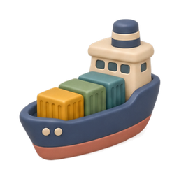
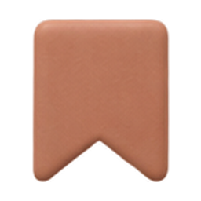
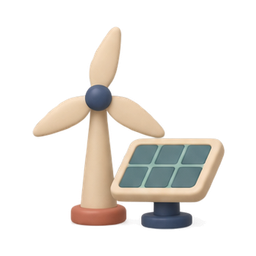

<div align="center">
  <h1>Kilnfield</h1>
  <p>Soft 3D icons for apps and websites.</p>
  <p>
    <a href="https://zacbytes.github.io/kilnfield/"></a>
    <a href="./catalog.json"></a>
    <a href="./ARTWORK-LICENSE.md"></a>
    <a href="https://github.com/ZacBytes/kilnfield/stargazers"></a>
  </p>
  <p>
    <a href="https://zacbytes.github.io/kilnfield/#icon=maritime"></a>
    <a href="https://zacbytes.github.io/kilnfield/#icon=bookmark"></a>
    <a href="https://zacbytes.github.io/kilnfield/#icon=renewables"></a>
    <a href="https://zacbytes.github.io/kilnfield/#icon=captions"></a>
    <a href="https://zacbytes.github.io/kilnfield/#icon=space"></a>
    <a href="https://zacbytes.github.io/kilnfield/#icon=star"></a>
  </p>
  <p><a href="https://zacbytes.github.io/kilnfield/"><strong>Explore the icons</strong></a> &nbsp;&nbsp;&nbsp; <a href="./assets">Browse the files</a></p>
</div>

## Use an icon

Search by name, appearance, or purpose. Try **“save for later”** for Bookmark, or **“clean power”** for Renewables. Open any result to copy the SVG or download an individual file.

Drop a downloaded icon into your app’s assets directory and reference it directly.

```html

```

Use an empty `alt` when nearby text already describes the icon. For an icon-only button, give the button an accessible name such as `aria-label="Save for later"`.

| Format | Use it for |
| --- | --- |
| **WebP** | A compact, lossless image for the web |
| **PNG** | A transparent image for design tools and apps |
| **SVG** | A self-contained file that embeds the 256 × 256 PNG and preserves the original shading |

Every icon has a stable ID in [the catalog](./catalog.json). Files are named `assets/<id>.webp`, `assets/<id>.png`, and `assets/<id>.svg`.

## Coverage

- **Navigation and layout** — arrows, chevrons, menus, panels, grids, and window controls.
- **Files and actions** — documents, folders, attachments, clipboard, archive, and sharing.
- **Text editing** — bold, italic, underline, alignment, lists, undo, and redo.
- **Accessibility** — wheelchair access, captions, contrast, text size, and keyboard input.
- **Communication and media** — mail, calls, images, microphones, and playback controls.
- **System and shopping** — account access, connectivity, theme controls, checkout, and payments.
- **Topic illustrations** — infrastructure, technology, society, environment, and country flags.

## License

Use and adapt the artwork in personal and commercial projects under **CC BY 4.0**. Credit Kilnfield, link to the license, and indicate changes.

> Icon by [Kilnfield](https://zacbytes.github.io/kilnfield/), [CC BY 4.0](https://creativecommons.org/licenses/by/4.0/).

[Artwork license and provenance](./ARTWORK-LICENSE.md).
